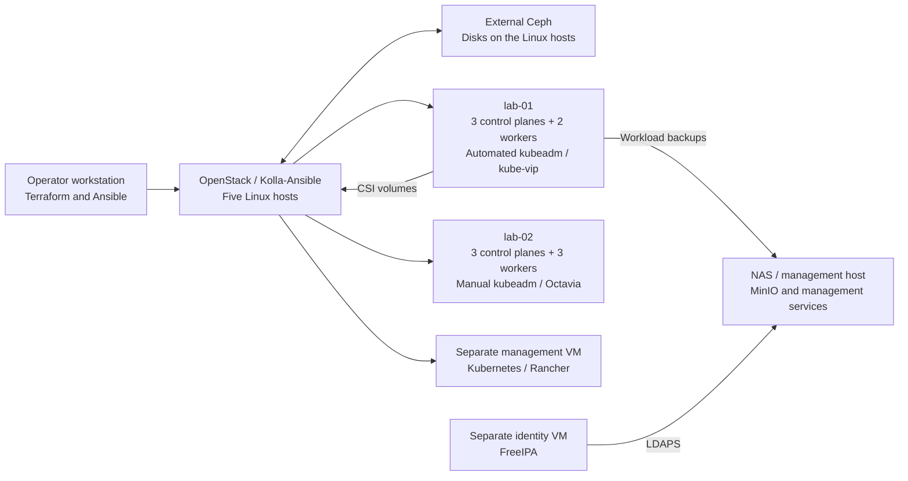

# Homelab development kit

A configurable build kit for my OpenStack and Kubernetes lab. It includes the cloud foundation, both Kubernetes labs, management services, and the tests used to develop the configuration.

The physical layout is five Linux machines plus a NAS. Kubernetes runs in tenant VMs; Ceph uses disks on the Linux hosts. Management and backup services stay outside the workload clusters.

Lab addresses, domains and hostnames are fictional examples. Upstream download URLs and software identifiers are real. Replace the lab examples with a reviewed network plan before deployment. Credentials, state, private keys and kubeconfigs stay outside Git.

## What it builds

| Layer | Implementation |
|---|---|
| Cloud foundation | Native Ansible, cephadm and Kolla-Ansible; external Ceph storage and OpenStack services |
| Cloud assets | Terraform image checksum verification, Glance image, flavors and Octavia flavor |
| lab-01 | 3 control planes, 2 workers; automated kubeadm, kube-vip and Cilium setup |
| lab-02 | 3 control planes, 3 workers; manual Kubernetes build with Octavia API and ingress endpoints |
| Management cluster | Separate VM and Kubernetes/Rancher installation path |
| Persistent storage and backup | Cinder CSI, retained volumes, Velero/Kopia and MinIO |
| Identity and services | FreeIPA, Keycloak, Forgejo, Vault, MinIO, Prometheus, Grafana, Alertmanager and n8n |



Both workload clusters share the cloud foundation. They are not independent sites, and the NAS is not a Ceph OSD.

## Start here

1. Read the [build order and prerequisites](docs/build.md).
2. Configure and build the [foundation](foundation/README.md).
3. Create the [cloud assets and VM cohorts](terraform/README.md).
4. Use [Ansible for lab-01](ansible/README.md) and the [manual lab-02 procedure](kubernetes/lab-02/README.md).
5. Deploy [management services](services/README.md), then configure [storage](kubernetes/storage/README.md), [backups](kubernetes/backup/README.md) and [Rancher](kubernetes/rancher/README.md).

Each component documents its editable inputs, native commands and protected outputs. Hardware, prepared operating systems, routing, initial DNS/NTP and trusted administrator access are prerequisites; this kit does not reimage existing machines.

## Develop and validate

Install Python 3.12+, Terraform 1.16.5, Ansible, Helm, Docker CLI/Compose, OpenSSL and `htpasswd`. The local validation route does not need a Docker daemon or cloud credentials.

```sh
python3.12 -m venv .venv
. .venv/bin/activate
python -m pip install -r requirements-dev.txt
ansible-galaxy collection install -r requirements-galaxy.yml
make test
make validate
```

Validation runs component fixtures, native Terraform schemas and provider-mock tests, Ansible syntax checks, Compose parsing, PKI checks and checksum-locked Helm renders. Dependencies may download from public registries. GitHub CI also builds the upstream-source MinIO image and exercises its version command on an ephemeral runner.

Make and CI do not deploy the lab. Deployment stays an operator-run action after input and plan review.

## Evidence and limits

Offline checks are not a clean-room deployment test. Live boot, networking, HA, SSO and restore acceptance still need a staged environment. My [completed lab-01 recovery exercise](docs/recovery.md) predates this kit and is not proof that this exact source rebuilt every service.

Native cephadm has its own SSH trust model; review the explicit boundary in the foundation guide. Release and chart pins identify dependencies, not vulnerability approval or a complete per-service OpenStack image-digest BOM. Review pinned releases before exposing services.

See [design decisions](docs/design.md), the [interview walkthrough](docs/demo.md) and [security guidance](SECURITY.md).
