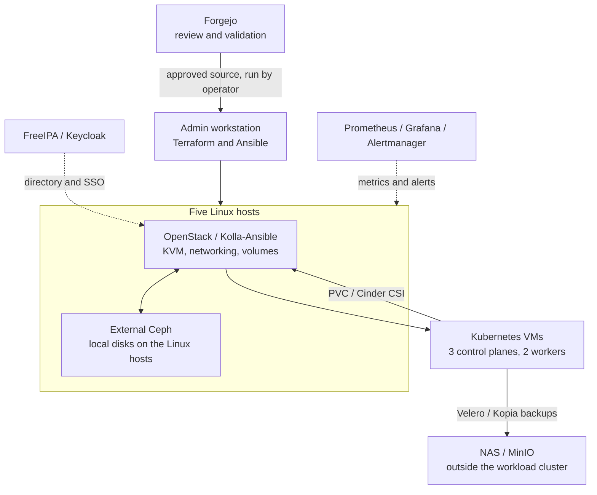

# My homelab

I use this lab to practice running a small private cloud: building VMs, connecting storage, running Kubernetes, and recovering an application after a rebuild.

It runs on five reused Linux machines and a NAS. I care more about understanding failures and making changes repeatable than collecting tools.

This is a simplified public overview, not the operational repository or a full deployment kit. All IPs, hostnames, and domains below are fictional examples. The architecture and recovery exercise describe the actual lab; they are not a live health report.

## How it fits together

The NAS also hosts management services. It is not a Ceph storage node.

## What I use

| Layer | Tools | Purpose |
|---|---|---|
| Private cloud | OpenStack, Kolla-Ansible, KVM | Run VMs and manage networks and volumes |
| Storage | Ceph RBD, Cinder, Cinder CSI | Give VMs and Kubernetes workloads persistent storage |
| Provisioning | Terraform, Ansible, kubeadm | Create cloud resources, then configure guests |
| Kubernetes | kubeadm, Cilium, kube-vip | Practice cluster operations on disposable VMs |
| Backup | Velero, Kopia, MinIO | Restore application objects and file data |
| Identity | FreeIPA, Keycloak | Central directory and supported application SSO |
| Operations | Prometheus, Grafana, Alertmanager, Forgejo | Observe the lab and review changes |

## Decisions I can explain

- Terraform owns cloud resources. Ansible configures the guests. I keep those jobs separate.
- Kubernetes control-plane VMs use hard anti-affinity so one hypervisor does not host all of them.
- A retained volume is not a backup. I use a separate backup path for application recovery.
- Git validation does not deploy infrastructure. An operator runs the approved source.
- The management and backup services sit outside the disposable Kubernetes cluster.

This is still one home site with shared power, networking, and a NAS. Multiple controllers do not make it a production disaster-recovery environment. I have completed a small workload restore, not a full clean-room rebuild of every service.

## Read more

- [Design and example addressing](docs/design.md)
- [Completed recovery exercise](docs/recovery.md)
- [Short interview walkthrough](docs/demo.md)
- [Example inventory](examples/inventory.ini)
- [Example Kubernetes storage class](examples/storageclass.yaml)

The examples are reference material. They contain no credentials, real endpoints, state files, or private Git history. They will not deploy the lab on their own.
